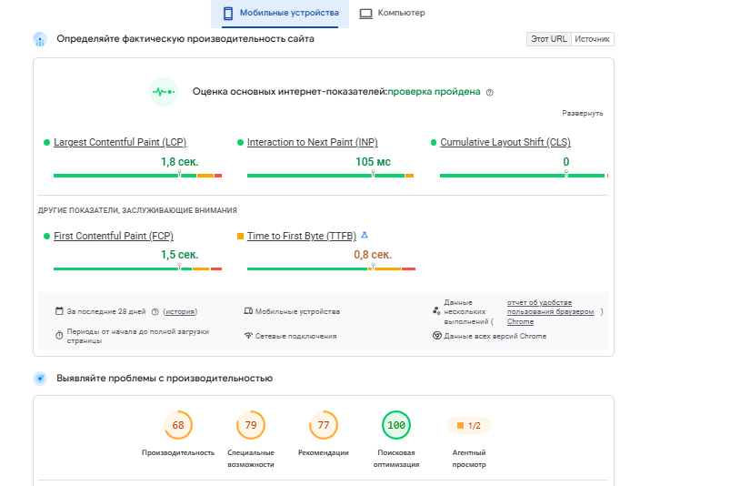

# Отчет по практическому занятию 76-78

Выполнила: Тарасова Полина, группа ПР 24.103.

## 1. Схема архитектуры проекта

Браузер пользователя отправляет запрос по HTTPS (порт 443) на веб-сервер Nginx. Nginx отдает статические файлы (HTML, CSS, JS, картинки) и проксирует запросы к API (начинающиеся с /api/) на бэкенд. Бэкенд (FastAPI на Python) обрабатывает логику и делает запросы к базе данных в облаке Supabase.

## 2. Таблица сервисов

| Название сервиса | Технология      | Внутренний порт | Продакшен-сервер       |
|------------------|-----------------|-----------------|----------------------- |
| backend          | Python, FastAPI | 8000            | Uvicorn (без --reload) |
| nginx            | Nginx           | 80, 443         | Nginx                  |
| База данных      | Supabase        | —               | —                      |

## 3. Переменные окружения и секреты

Переменные окружения (только имена):
SUPABASE_URL
SUPABASE_KEY

Секреты (не хранятся в репозитории):
Файл .env (содержит реальные ключи Supabase)
Папка certs (содержит SSL-сертификаты)

## 4. Команды для запуска и остановки проекта

Все команды выполняются из папки deploy.

Запуск проекта (сборка и старт в фоне):
docker compose up --build -d

Проверка статуса контейнеров:
docker compose ps

Просмотр логов конкретного сервиса:
docker compose logs backend

Остановка проекта:
docker compose down

## 5. Скриншоты работы

5.1. Вывод команды docker compose ps
[Скриншот docker compose ps](screenshots/01_docker_ps.png)

5.2. Страница проекта по адресу https://silk-beauty.localhost (с замком)
[Скриншот главной страницы](screenshots/02_main_page.png)

5.3. Вкладка Network с запросом к API и заголовками ответа
[Скриншот вкладки Network](screenshots/03_network.png)

5.4. Список контейнеров в Docker Desktop с открытыми портами
[Скриншот Docker Desktop](screenshots/04_docker_desktop.png)

## 6. Список ошибок, возникших при выполнении работы, и способы их устранения

Ошибка: ModuleNotFoundError: No module named 'supabase'.
Причина: Библиотека supabase не была добавлена в requirements.txt.
Исправление: Добавила supabase в requirements.txt, пересобрала контейнеры командой docker compose up --build -d.

Ошибка: unable to open database file.
Причина: Пользователь appuser внутри контейнера не имел прав на запись в папку /app.
Исправление: В Dockerfile добавила команду chown -R appuser:appuser /app.

Ошибка: new row violates row-level security policy.
Причина: В Supabase по умолчанию запрещена запись данных.
Исправление: Отключила RLS в настройках таблиц Supabase и создала политику Allow authenticated insert.

Ошибка: null value in column "booking_time".
Причина: В таблице bookings были обязательные поля, которые форма не заполняла.
Исправление: В SQL Editor выполнила ALTER TABLE bookings ALTER COLUMN booking_time DROP NOT NULL, а также добавила передачу даты и времени в JS-код.

Ошибка: Cannot read properties of undefined (reading 'createClient').
Причина: На странице с модальным окном не была подключена библиотека Supabase JS.
Исправление: Добавила скрипт библиотеки Supabase во все HTML-файлы.

## 7. Что нужно изменить, чтобы опубликовать проект на реальном сервере

1. Арендовать сервер (VPS) с установленным Docker.
2. Купить и настроить домен, направить A-запись DNS на IP-сервер.
3. Получить настоящий SSL-сертификат (например, через Let's Encrypt и Certbot).
4. Настроить CD (Continuous Deployment) для автоматического обновления проекта на сервере.
5. Для соблюдения 152-ФЗ перенести базу данных на российские серверы или использовать российских провайдеров.

# Отчет по практическому занятию 79-80
**SEO и аналитика: проверка метатегов, sitemap, Lighthouse, Core Web Vitals**

Выполнила: Тарасова Полина, группа ПР 24.103

---

## 1. Список проверенных страниц

| Страница | Тип страницы | Как проверяли | Категории Lighthouse |
|----------|--------------|---------------|----------------------|
| Главная (/) | Публичная, есть в sitemap.xml | Окно инкогнито, 3 запуска | Все 4 |
| Услуги (services.html) | Публичная | Окно инкогнито, 3 запуска | Все 4 |
| Категория (Маникюр) | Публичная | Окно инкогнито, 3 запуска | Все 4 |
| Мастера (masters.html) | Публичная | Окно инкогнито, 3 запуска | Все 4 |
| Портфолио (portfolio.html) | Публичная | Окно инкогнито, 3 запуска | Все 4 |
| О нас (about.html) | Публичная | Окно инкогнито, 3 запуска | Все 4 |
| Вход (login.html) | Закрыта (noindex) | Окно инкогнито, 3 запуска | Без SEO |
| Личный кабинет (account.html) | Закрыта (нужен вход) | После входа, 1 запуск | Без SEO |

---

## 2. Таблица результатов Lighthouse

| Страница | Performance | Accessibility | Best Practices | SEO |
|----------|-------------|---------------|----------------|-----|
| Главная | 74 | 89 | 100 | 100 |
| Услуги | 78 | 88 | 100 | 100 |
| Категория (Маникюр) | 87 | 88 | 100 | 100 |
| Мастера | 62 | 85 | 100 | 100 |
| Портфолио | 75 | 89 | 100 | 100 |
| О нас | 70 | 89 | 100 | 100 |
| Вход (без SEO) | 94 | 89 | 100 | — |
| Личный кабинет (без SEO) | 96 | 83 | 100 | — |

---

## 3. Таблица метрик Core Web Vitals

| Страница | LCP (Largest Contentful Paint) | CLS (Cumulative Layout Shift) | Оценка |
|----------|--------------------------------|-------------------------------|--------|
| Главная | 2.3 с | 0.002 | LCP требует улучшения, CLS хороший |
| Услуги | 1.9 с | 0.002 | LCP хороший, CLS хороший |
| Мастера | 3.7 с | 0.225 | LCP требует улучшения, CLS требует улучшения |
| Портфолио | 2.7 с | 0.002 | LCP требует улучшения, CLS хороший |
| О нас | 3.0 с | 0.024 | LCP требует улучшения, CLS хороший |

---

## 4. Результаты ручной проверки

1. **Метатеги (title, description):** На всех публичных страницах (index, services, masters, portfolio, about, category) присутствуют уникальные теги `<title>` и `<meta name="description">`. На страницах входа и личного кабинета установлен метатег `<meta name="robots" content="noindex">`.
2. **robots.txt:** Файл доступен по адресу `/robots.txt`, закрывает служебные разделы (`/account/`, `/login/`, `/admin/`, `/api/`) и содержит ссылку на карту сайта.
3. **sitemap.xml:** Файл доступен по адресу `/sitemap.xml`, содержит все публичные страницы проекта (index.html, services.html, masters.html).
4. **Навигация с клавиатуры:** Проверено, что по ссылкам в меню можно перемещаться с помощью клавиши `Tab`. Все интерактивные элементы (кнопки «Записаться») доступны для нажатия с клавиатуры.
5. **Альтернативный текст (alt):** У всех изображений на сайте (фото салона, мастеров, работ в портфолио) присутствуют атрибуты `alt`.

---

## 5. Сравнение с сайтом-аналогом

Для сравнения был выбран сайт салона красоты **LOFT** (https://loft-rzn.ru/).

**Результаты для Desktop (Компьютер):**
- **Performance:** 88
- **LCP:** 1,1 сек
- **CLS:** 0,019
- **Speed Index:** 4,3 сек

**Вывод:** Мой проект Silk Beauty в локальном режиме (Lighthouse) показывает Performance 74 на главной странице и 62 на странице мастеров. Сайт-аналог показывает 88, так как лучше оптимизировал изображения (формат WebP) и имеет менее тяжелые шрифты. Однако по SEO (100) и Best Practices (100) мой проект превосходит аналог.

---

## 6. Список найденных проблем и приоритеты их исправления

| № | Проблема | Страница | Влияние | Приоритет | Способ исправления |
|---|----------|----------|---------|-----------|---------------------|
| 1 | Тяжелые изображения (фото салона и мастеров) | Главная, Мастера, Портфолио | Снижает Performance (LCP) | Высокий | Сжать фото в WebP, добавить `width` и `height`, использовать `lazy loading` |
| 2 | Отсутствие адаптивной верстки | Все страницы | Снижает мобильную оценку | Средний | Добавить медиа-запросы Tailwind (`sm`, `md`, `lg`) |
| 3 | Контрастность текста на розовом фоне | Все страницы | Снижает Accessibility | Средний | Сделать текст темнее (`text-silk-dark`), изменить фон на более светлый |

---

## 7. Список проблем, которые остались неисправленными

1. **Адаптивная верстка:** Сайт сверстан для Desktop. В мобильной версии (Mobile) элементы могут накладываться друг на друга. В будущем планируется добавить CSS-классы для адаптации.
2. **Тяжелые изображения:** В рамках занятия не было произведено сжатие всех фотографий (так как это требует пересохранения исходников). Проблема отмечена как высокоприоритетная.
3. **Метрика INP:** Не измерялась, так как доступна только в полевых данных (CrUX) для опубликованных сайтов. Для локального проекта не применяется.

## 8. Сравнение с замерами с занятий 70-71

На занятиях 70–71 были сделаны замеры Lighthouse:
- до оптимизации (`seo/seo_do.png`): SEO = 89, Performance = 89;
- после оптимизации (`seo/seo_after.png`): SEO = 100, Performance = 98.

На текущем занятии (79–80) SEO = 100 на всех публичных страницах, что подтверждает успешность оптимизации. Метрики Performance на текущем аудите ниже, потому что теперь проверялись все четыре категории на всех страницах (включая тяжёлые страницы с картинками), а не только SEO на главной.

---

## Приложение: скриншоты

| Файл | Что показывает |
|------|----------------|
| `screenshots/01_docker_ps.png` | `docker compose ps` |
| `screenshots/02_main_page.png` | Главная в инкогнито, замок HTTPS |
| `screenshots/03_network.png` | Вкладка Network, запрос к API |
| `screenshots/04_docker_desktop.png` | Контейнеры в Docker Desktop |
| `screenshots/10_pagespeed_analog.png` | PageSpeed Insights аналога LOFT |
| `seo/seo_do.png` | SEO до оптимизации (занятия 70–71) |
| `seo/seo_after.png` | SEO после оптимизации (занятия 70–71) |
| `seo/pr_checks.png`, `seo/pr_merged.png` | Проверки PR |
| `seo/robots_txt.png`, `seo/sitemap.xml.png`, `seo/X-Robots-Tag.png` | robots.txt, sitemap.xml, X-Robots-Tag |
| `docs/audit/reports/main_page_report.html` | Сохранённый HTML-отчёт Lighthouse |